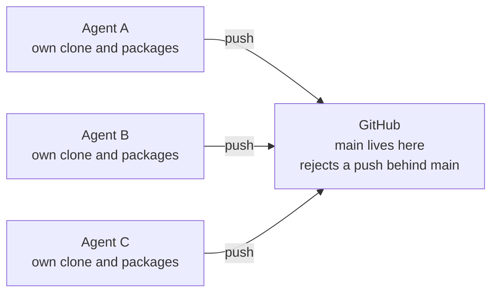
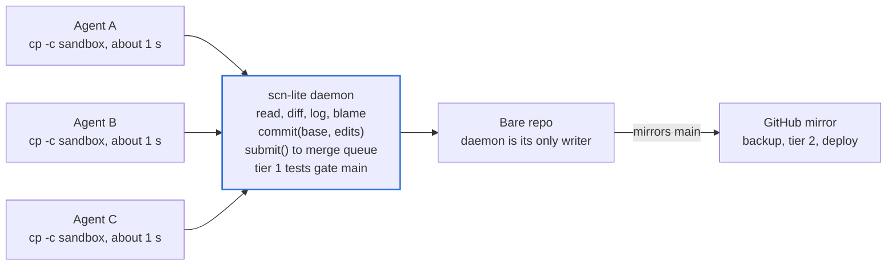
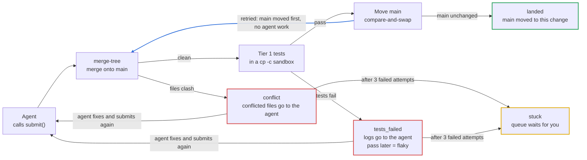

# scn-lite: plan and expected improvements

As of 2026-10-20. Source: [scn-lite.md](./scn-lite.md).

## Summary

We will build scn-lite in about 2.5 working days. Agents then land code on main through one daemon on the Mac mini. They stop pushing to GitHub from their own clones.

Today each agent owns a full clone and pushes to GitHub by itself. Agents find out about each other only when a push fails. New tasks wait minutes for a clone and a package install. A change that keeps failing stays out of sight until you open its PR.

scn-lite puts one daemon in front of a bare git repo. Agents call it to read code, commit and submit. A merge queue tests each change and moves main. GitHub becomes a mirror and a backup. The repo stays plain git.

**Decision for review:** approve the five build steps below, or mark the steps to change.

## How work flows

Agents stop talking to GitHub. They talk to one daemon, and the daemon is the only writer of main.

### Today

Agents find out about each other only when a push fails.

### With scn-lite

Sandboxes are APFS clones on the same volume, so each one takes about 1 second to make. GitHub gets every change to main as a mirror.

## Life of one change

The agent's job ends at `submit()`. The daemon decides if the change lands.

Red paths need more agent work. The blue path is automatic: another change landed first, so the daemon merges again. The daemon writes one SQLite row for each attempt, whatever the outcome.

## What will be done

We build five steps in order. The total is about 2.5 working days. Each step ends with a check you can run on the Mac mini.

| Step                            | What we build                                                                                                                                                                                                                         | Time       | Done when                                                                                    |
| ------------------------------- | ------------------------------------------------------------------------------------------------------------------------------------------------------------------------------------------------------------------------------------- | ---------- | -------------------------------------------------------------------------------------------- |
| 1. Agents volume                | An APFS volume with Spotlight and the fseventsd log off. The package caches move to it.                                                                                                                                               | 15 min     | `cp -c` of a repo on the volume takes about 1 second. `mdutil -s` shows indexing off.        |
| 2. Daemon over the bare repo    | `read`, `diff`, `log`, `blame` and `commit(base, edits)` on top of git plumbing.                                                                                                                                                      | 1 day      | A script commits through the daemon. `git log` on the bare repo shows the commit.            |
| 3. MCP server                   | The daemon calls as tools for agent sessions. Agents use them in place of their own git commands.                                                                                                                                     | 2 hours    | An agent session reads a file and commits through the tools with no shell git.               |
| 4. Merge queue with attempt log | `merge-tree`, the tier 1 gate in a `cp -c` sandbox, compare-and-swap on main, the SQLite log and a retry cap of 3.                                                                                                                    | 1 day      | Two agents submit at once. Both land in order, and `scn log` shows one row for each attempt. |
| 5. Self-hosted runner           | The GitHub Actions runner as a `ci` user under launchd with `ProcessType Background`. Its work folder is on the Agents volume. `runs-on: self-hosted`, deploy behind `needs:`. The daemon's token bypasses branch protection on main. | half a day | A push to the mirror runs tier 2 on the Mac mini. A deploy starts only after tier 2 passes.  |

**Later, not in this plan:** a SQLite history index, a flaky test report, approval rules for paths such as `infra/`, a Linux VM runner for Linux and container jobs, and a monitor agent that reads the attempt log.

## Improvements we expect

The largest gain is on task start: minutes go down to about 1 second. Races and conflicts stop costing agent work. The "How we measure" column says how we check each claim after step 4.

| When you                  | Today                                                               | With scn-lite                                                                              | How we measure                                                     |
| ------------------------- | ------------------------------------------------------------------- | ------------------------------------------------------------------------------------------ | ------------------------------------------------------------------ |
| Start an agent task       | Clone or add a worktree, then install packages. This takes minutes. | The daemon makes a `cp -c` sandbox in about 1 second. Packages come from the shared store. | Time from task start to first edit, before and after.              |
| Read code or history      | The agent runs `git log` and `git blame` in its own copy.           | The agent calls `read`, `log` or `blame`. Later, a SQLite index answers history questions. | Number of shell git calls in agent sessions. Target: zero.         |
| Commit                    | `git add`, `commit` and `push` from each worktree.                  | One `commit(base, edits)` call. Nothing to push.                                           | Tool calls for each commit.                                        |
| Land on main              | Push or open a PR. GitHub rejects a push that is behind main.       | Call `submit()`. The queue merges, tests and moves main.                                   | Time from submit to landed, from the attempt log.                  |
| Two agents finish at once | One push wins. The other agent fetches, rebases and tries again.    | The queue takes them in order. A lost race retries with no agent work.                     | `retried` rows in the attempt log that landed with no agent turn.  |
| Hit a conflict            | Found at push or PR time. The agent rebases in its worktree.        | Found by `merge-tree` before tests run. The agent gets the conflicted files.               | `conflict` rows that never started a test run.                     |
| A change keeps failing    | The agent keeps trying. You find out when you open the PR.          | After 3 failed attempts the queue parks it as `stuck`. It shows in `scn queue`.            | Count of `stuck` changes each week. Each one is seen the same day. |
| Use file watchers         | HMR and `tsc --watch` work everywhere.                              | Watchers do not fire on the Agents volume. Keep watched projects on the main volume.       | Not a gain. See the risks section.                                 |
| Edit by hand in your IDE  | Clone from GitHub as usual.                                         | The same. Your clone pulls from the GitHub mirror.                                         | No change.                                                         |

**CI changes in two tiers.** Tier 1 decides if a change lands, so it must stay fast. Tier 2 decides if a commit deploys, so it can be slow. Both run on the Mac mini at background priority, so CI does not slow the queue or the agents.

**Failures become visible.** The daemon writes one SQLite row for each queue attempt and never deletes rows. Run `scn queue` for live work and `scn log --failed` for history.

## Costs and risks

The main cost is that one Mac mini now carries the agents, the queue and CI. If it stops, nothing lands. GitHub still holds main up to the last mirror push.

| Risk                                           | Effect                                                  | What we do                                                                              |
| ---------------------------------------------- | ------------------------------------------------------- | --------------------------------------------------------------------------------------- |
| One machine for agents, queue and CI           | A Mac mini outage stops all landing.                    | GitHub mirror is the backup. You can push to GitHub by hand until the Mac mini is back. |
| Daemon token bypasses branch protection        | Anyone with that token can write main on GitHub.        | Keep the token only in the daemon's keychain. Scope it to one repo.                     |
| Green tests are the only gate                  | A change with weak tests lands with no human look.      | Keep tier 1 strict. Add approval rules for paths such as `infra/` later.                |
| File watchers do not fire on the Agents volume | HMR and `tsc --watch` do not work in sandboxes.         | Keep projects that need watchers on the main volume.                                    |
| No Linux or container jobs                     | Jobs that need Linux cannot run on the Mac mini runner. | Keep them on GitHub-hosted runners until the Linux VM runner is built.                  |
| Tier 1 gets slow                               | Every submit waits longer, and the queue backs up.      | Watch submit-to-landed time in the attempt log. Move slow tests to tier 2.              |

The repo stays plain git, and GitHub keeps every change to main. To back out, point agents at GitHub again and stop the daemon.

## Open questions

- [ ] Which repos move to scn-lite first? One repo is the smallest test.
- [ ] Which tests make up tier 1, and what is its time limit?
- [ ] Is a retry cap of 3 right before a change is `stuck`?
- [ ] Do we want a human approval step before the first week of use, or only later?
- [ ] Which projects need file watchers and must stay on the main volume?
